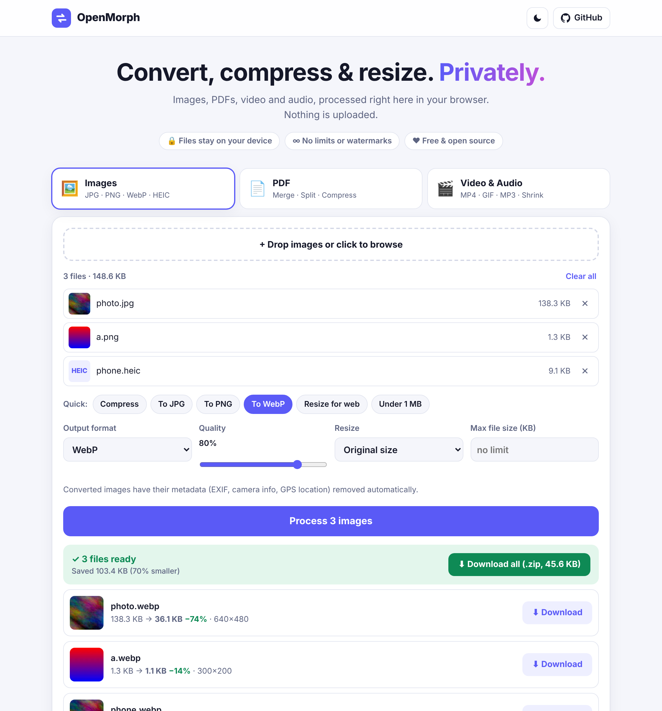

<div align="center">

# OpenMorph

**Convert, compress and resize images, PDFs, video and audio. Privately, in your browser.**

A free, open-source alternative to the "convert X to Y" websites. No uploads, no accounts, no limits, no watermarks.

**[Open the app → openmorph.vercel.app](https://openmorph.vercel.app)**

[](https://github.com/xeej0/openmorph/actions/workflows/ci.yml)
[](LICENSE)



</div>

## Why

Most online converters upload your files to someone else's server, cap file sizes, add watermarks or push a subscription. OpenMorph does the work with code that runs **on your own device**. Your files never leave your computer or phone.

## Features

### 🖼️ Images
- Convert between **JPG, PNG, WebP, AVIF**. Opens GIF, BMP, SVG and **iPhone HEIC** photos too.
- **Compress** with a quality slider, or set a **max file size** ("under 200 KB") and it finds the best quality that fits.
- **Resize** by percentage or to fit a max width/height.
- Strips EXIF and **GPS location** data automatically.
- Never hands you back a bigger file than you started with.

### 📄 PDF
- **Images → PDF** (A4, Letter or same size as the image, with margins)
- **Merge** PDFs (drag to reorder)
- **Split** or extract pages (`1-3, 5, 8-`)
- **PDF → images** (PNG, JPG, WebP at 72/150/300 DPI)
- **Compress**: light (keeps text) or strong (great for scans)
- **Rotate** all or selected pages

### 🎬 Video & audio
- Convert to **MP4, WebM, MOV, MKV, GIF**, or **GIF → MP4**
- Extract audio as **MP3, M4A, WAV, OGG, Opus, FLAC**
- **Shrink** videos by quality and resolution, or **fit under a size** (e.g. 10 MB / 25 MB for chat apps)
- **Trim** start/end, remove audio, preview the result before downloading

### Everywhere
- Batch processing with **Download all as ZIP**
- Drag files anywhere on the page, or **paste** with Ctrl/Cmd+V
- Works on phones, keyboard accessible, light and dark mode

## Privacy and security

- **No server processing.** The site is static files. Conversion uses the Canvas API, [pdf-lib](https://pdf-lib.js.org/), [PDF.js](https://mozilla.github.io/pdf.js/), [ffmpeg.wasm](https://github.com/ffmpegwasm/ffmpeg.wasm) and [heic2any](https://github.com/alexcorvi/heic2any), all running in your browser.
- **Enforced by the browser.** A strict [Content Security Policy](vercel.json) sets `connect-src 'self'`, so the page is not *able* to send data to any other site, even if a dependency misbehaved.
- **No third-party requests.** No analytics, no ads, no CDNs, no fonts from elsewhere. The video engine is self-hosted.
- **Tested.** CI fails if the page makes a single request to another origin.

`'unsafe-eval'` is allowed in the CSP only because the HEIC decoder (heic2any) needs it. Found a security issue? See [SECURITY.md](SECURITY.md).

## Limits

- Video runs single-threaded in WebAssembly, so long or 4K videos are slower than a desktop app. Files up to about 1.5 GB.
- Animated GIFs are kept as-is in the image tool. Use **Video & Audio → GIF** to shrink them.
- "Strong" PDF compression turns pages into images, so text is no longer selectable.

## Run it yourself

```bash
git clone https://github.com/xeej0/openmorph
cd openmorph
npm ci
npm run dev
```

| Command | What it does |
|---|---|
| `npm run dev` | Dev server with hot reload |
| `npm run build` | Static site in `dist/` |
| `npm test` | Builds must exist first. Runs 34 end-to-end checks in Chromium, under the production security headers |

Requires Node 20+. Any static host works. For Vercel, import the repo (settings come from `vercel.json`) or:

[](https://vercel.com/new/clone?repository-url=https://github.com/xeej0/openmorph)

## Project layout

```
index.html          markup
src/main.js         tabs, theme, drag-and-drop / paste routing
src/image.js        image tool (Canvas, HEIC)
src/pdf.js          PDF tools (pdf-lib, PDF.js)
src/media.js        video & audio (ffmpeg.wasm)
src/util.js         file list, results, helpers
tests/e2e.mjs       end-to-end tests + fixtures
vercel.json         security headers and caching
```

## Contributing

Issues and pull requests are welcome. Please run `npm run build && npm test` before opening a PR.

## License

[MIT](LICENSE). Bundled libraries keep their own licenses (ffmpeg.wasm core: GPL-2.0-or-later via FFmpeg and x264; pdf-lib, JSZip, heic2any: MIT; PDF.js: Apache-2.0).
